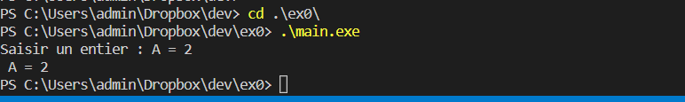

## Rappel : loi d'Ohm

La tension aux bornes d'une résistance vaut $U = R \cdot I$. On utilise la fonction `digitalWrite()` pour piloter la broche.

!!! definition "Résistance de protection"
    Elle **limite le courant** dans la LED :

    $$
    R = \frac{V_{CC} - V_{LED}}{I_{LED}}
    $$

## Câblage

| Composant | Broche Arduino | Entrée / sortie |
|-----------|----------------|-----------------|
| LED       | 3              | sortie          |
| BP        | 2              |                 |

!!! consigne
    Compléter le tableau ci-dessus, puis calculer $R$ pour $I_{LED} = 10\,mA$.

<!-- zone: 4 -->

## Programme

Le programme de départ, à compléter :

```cpp
const int LED_PIN = 3;

void setup()
{
    pinMode(LED_PIN, OUTPUT);
}

void loop()
{
    digitalWrite(LED_PIN, HIGH);
    delay(500);
    digitalWrite(LED_PIN, LOW);
    delay(500);
}
```

Étapes :

1. Téléverser le programme.
2. Mesurer la période à l'oscilloscope.
3. Modifier le délai pour obtenir *1 Hz*.



Le fichier complet est téléchargeable [ici](blink.ino). Documentation : [Arduino digitalWrite](https://docs.arduino.cc/language-reference/).

!!! warning "Attention"
    Ne jamais brancher une LED **sans résistance**.
